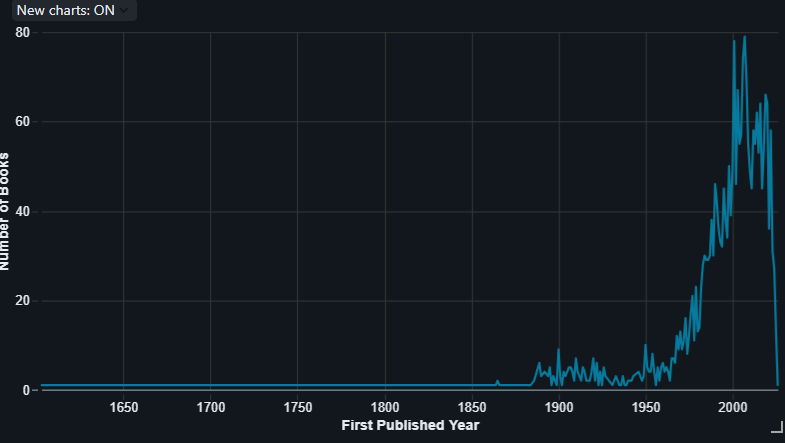
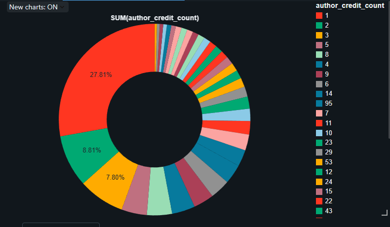

# Databricks Open Library ELT Pipeline
ELT Medallion Architecture Pipeline Project using the Open Library API and Databricks (Python/SQL)

# Initial Setup
This project uses the Open Library Book Search API. This API limits traffic per IP address to an unspecified modest amount, and will not allow for large dataset extracts. Because of this limitation, I have decided to work on a dataset of 2500 entries, sorted default by "relevance."

For examining the full breadth of data, I will download and analyze the "data dump" files (30+ GB) using Python in a separate project.

# Process
### Extract
Using Python `requests` library, query for 2500 total entries (500 per page, 1 second interval) from the Open Library Book Search API, specifying in `params` for Fantasy subject books. 

### Load
Then using `spark` we create a DataFrame that is saved into a Table in the Databricks Unity Catalog. This is saved as the bronze table in the Medallion architecture.

### Transform
Using the bronze table, we create our silver table by specifying correct data type casting for each row.

Then using the clean silver table, we begin created aggregated gold tables:
1. The first gold table aggregates based on the `first_publish_year` of each book.
2. The second gold table aggregates based on `author_credited` which is a new column we create by unnesting the `author_name` array column.

# Findings
 

Using the Databricks built in Visualization tool, I created a Line Graph to represent books per year, and a Pie Chart to represent number of authors per count of credited books.

I found that in our sample dataset, there is a clear upwards trend of fantasy books published from the past to present, with a peak of 79 books in 2007. 

I also found that the largest group of authors have been credited for only one book (27.81%), however over 50% of authors have been credited for at least 8 books! 

Of course, this applies only to my specific sample dataset of 2500 books, and I am not confident the "relevance" sort will reliably provide reproducible results when another user runs the pipeline. Perhaps to change this the project can instead focus on most recent additions to the Open Library server and schedule trigger a pipeline to confirm data validity and data trends.